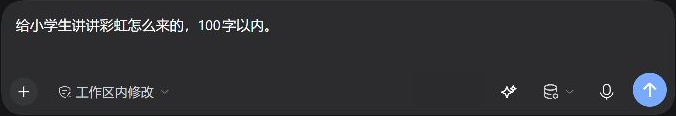
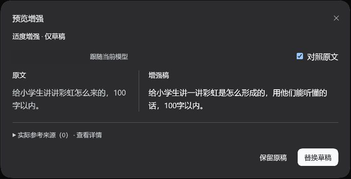
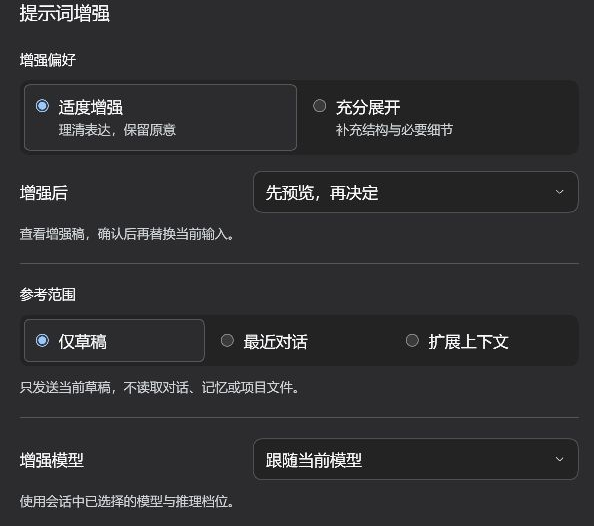

# DSH Prompt Improver · 提示词增强

简体中文 · [English](README.en.md)

在 DSH 输入框中，把草稿整理成更清晰的提示词。直接替换，或先对照预览，再决定是否采用。

**插件 0.2.6 · 适配 DSH 0.2.1-rc.3 · MIT 许可证**

已收录到 **dsh-market**：[市场页面](https://awesome-dsh-plugin.com/p/Yocaihua8/dsh-prompt-improver/) · [收录记录](https://github.com/awesome-dsh-plugin/awesome-dsh-plugin/pull/9972)。

[插件市场](#通过插件市场安装) · [安装与上手](#安装与上手) · [常用设置](#常用设置) · [使用指南](docs/guide.md) · [问题反馈](https://github.com/Yocaihua8/dsh-prompt-improver/issues)

## 看看它如何工作

### 在输入框中一键增强

写下草稿，点击输入框底部的星光按钮。增强只修改草稿，不会自动发送消息。



### 对照原文，再决定是否采用

选择“先预览，再决定”，即可并排查看原文与增强稿。点击“替换草稿”采用结果，或“保留原稿”继续编辑。



### 按需要调整增强方式

在 **DSH 设置 → 提示词增强** 中选择增强方式、参考范围和模型，点击“保存设置”生效。



*以上为 2026-10-27 在 DSH 0.2.1-rc.3 / 插件 0.2.3 中重新截取的真实界面；0.2.4、0.2.5 的构建和依赖修订，以及 0.2.6 的包名变更均未改变界面。演示使用“仅草稿、先预览”，并非首次默认配置；图片仅保留相关界面，个人配置字段已遮盖。*

## 安装与上手

### 安装前

- 已安装 **DSH 0.2.1-rc.3**，并配置好可用模型。
- 能访问 GitHub 和 npm 依赖源。

### 通过插件市场安装

打开[市场安装页面](https://awesome-dsh-plugin.com/p/Yocaihua8/dsh-prompt-improver/)查看截图和安装方式。已安装 `dshmarket` 的用户，也可在 DSH 的“插件市场”中搜索 `dsh-prompt-improver`。

市场条目目前指向 **v0.2.6** 的预构建包。不同分发源可能存在同步延迟；搜索不到时，可先通过市场页面或下方 Release 入口安装。

### 从 GitHub Release 安装

从 [v0.2.6 Release](https://github.com/Yocaihua8/dsh-prompt-improver/releases/tag/v0.2.6) 下载 `.tgz` 安装包和 SHA-256 校验文件，或使用下面的命令从同一版本标签安装。两种方式均包含预构建的 `lib`，无需在本机编译插件。

**旧版用户注意**：0.2.6 起仓库和安装包改名为 `dsh-prompt-improver`。已安装 `dsh-link-prompt-enhance` 的用户须先按[改名迁移步骤](docs/guide.md#从旧包名迁移)移除旧包，再安装新包；现有增强设置继续沿用。

使用 DSH Desktop 时，先备份原插件和 desktop profile 配置，等待任务结束并正常退出 DSH，再运行以下 PowerShell 命令。将占位路径替换为实际安装目录：

```powershell
$dshCli = '<DSH 安装目录>\resources\runtime\cli\bin\dsh.cmd'
& $dshCli plugin --profile desktop add 'github:Yocaihua8/dsh-prompt-improver#v0.2.6'
```

使用 **DSH Desktop 自带的 CLI**。独立 CLI 用户将 `desktop` 替换为已有 Web profile 的名称。Release 安装包、开发分支及回滚步骤见[安装与回滚指南](docs/guide.md#安装与回滚)。

需要修改源码时，可以单独克隆本仓库，运行 `npm ci`、`npm run check` 和 `npm pack`；构建脚本与契约源文件均已包含。环境要求和完整命令见[开发说明](docs/development.md)。

0.2.5 将仓库锁定依赖的审计告警从 40 项降至 0 项，继续适配 DSH 0.2.1-rc.3。该结果针对本仓库的依赖树，宿主自带依赖不由插件覆盖；范围及兼容验证见[验证记录](docs/verification.md)。

### 第一次增强

1. 重启 DSH，在普通会话的输入框中写下草稿。
2. 点击模型选择器左侧的**星光按钮**，等待增强完成。
3. 默认直接替换草稿；检查内容后自行发送。希望先比较结果，可在设置中改为“先预览，再决定”。

增强进行中，再次点击同一按钮可取消。采用结果后，按钮会变成返回图标，点击即可恢复本次增强前的原文。

## 常用设置

| 设置 | 首次默认值 | 什么时候调整 |
| --- | --- | --- |
| 增强方式 | 适度增强 | 理清表达、保留原意；需要补充结构与必要细节时选“充分展开” |
| 增强后 | 直接替换草稿 | 希望先对照检查时，选“先预览，再决定” |
| 参考范围 | 最近对话 | 独立问题选“仅草稿”；需要记忆和项目片段时选“扩展上下文” |
| 增强模型 | 跟随当前模型 | 希望与聊天使用不同模型时，选“指定专用模型” |

升级会保留已有设置；旧版增强方式会在首次读取时迁移。专用模型不可用时会提示失败，不会自动换用其他模型。更多说明见[使用指南](docs/guide.md)。

## 数据与费用

- 草稿和所选参考范围内的内容会发送给增强模型，费用按该模型服务的规则计算。
- “仅草稿”不读取历史、记忆或项目文件；“最近对话”最多参考最近 3 轮已完成对话。
- “扩展上下文”可读取个人及同项目记忆、当前项目片段，需要宿主所有者权限和相应服务支持；不会写入记忆。
- 增强不会上传附件正文，结构化 `@引用` 会校验并恢复。模型仍可能遗漏要求，采用后请检查内容。

读取范围、限制及异常处理见[数据与上下文](docs/guide.md#数据与上下文)。

## 更多文档与反馈

- [使用指南](docs/guide.md)：预览、恢复原文、设置、安装与常见问题。
- [开发说明](docs/development.md)：工作区依赖、构建检查、接口和测试。
- [验证记录](docs/verification.md)：按日期保留的测试、安装和实测证据。
- [提交问题或建议](https://github.com/Yocaihua8/dsh-prompt-improver/issues)：请附版本、复现步骤及脱敏后的截图。
- [MIT 许可证](LICENSE)。
